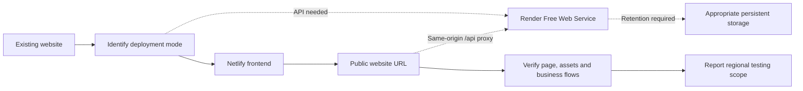

<div align="center">


# AI Website Deploy Skill

### Free website deployment. Optional backend hosting. Real end-to-end checks.

**An agent skill that takes an existing website from your local project to a working public URL.**

[](SKILL.md)
[](https://www.netlify.com/)
[](https://render.com/)
[](references/access-and-data.md)

[Quick start](#-quick-start) · [How it works](#-how-it-works) · [User data](#-optional-backends-and-user-data) · [Regional access](#-mainland-china-and-overseas-access) · [Chinese guide](README.zh-CN.md)

</div>

---

## ✦ Your website is built. Now make it reachable.

Building a site with an AI coding agent is only part of the journey. You still need to choose the publish directory, connect a private repository, configure an API, protect credentials, and verify that the public website actually works.

**AI Website Deploy Skill turns that deployment workflow into reusable agent instructions.** It starts with your existing project, preserves its design, prefers available free hosting plans, and adds infrastructure only when your application needs it.

> This is a **skill**, not a website builder, starter template, hosting provider, or unlimited free cloud service. Bring an existing website and your own platform accounts. The agent uses the connectors, official CLIs, or browser capabilities available in its environment.

<table>
<tr>
<td width="33%"><h3>↗ Deploy your frontend</h3><p>Identify the existing framework, build command, and publish directory. Deploy to Netlify without redesigning your site.</p></td>
<td width="33%"><h3>⌘ Add a backend if needed</h3><p>Connect a Render Free Web Service for APIs, computation, or shared state. A static website stays frontend-only.</p></td>
<td width="33%"><h3>✓ Verify the real flow</h3><p>Test the public website, assets, and API together. For write features, create a test record and read it back independently.</p></td>
</tr>
</table>

## ⚡ Quick start

### 1. Install the skill

Ask Codex to install the skill from this repository:

```text
Install the agent skill from:
https://github.com/chrisoops500/ai-website-deploy-skill
```

Or clone into an unused local skills directory:

```bash
git clone https://github.com/chrisoops500/ai-website-deploy-skill.git \
  ~/.codex/skills/ai-website-deploy-skill
```

If a skill with that name already exists, compare it before replacing it. Start a new conversation after installation. Other compatible agents may use different skill directories; follow your client's instructions.

### 2. Open your existing website project

| Deployment mode | What you need |
| --- | --- |
| Frontend only | Website source and a Netlify account |
| Frontend + backend | The above, plus a Render account and accessible Git repository |
| Frontend + persistent user data | The above, plus retention requirements and an appropriate storage connection |

### 3. Ask your agent to deploy it

```text
Use $ai-website-deploy-skill to deploy this existing website.
Prefer free hosting plans. Preserve the design and keep the source repository private.
Add a Render backend only if the application needs one.
If user data must persist, choose storage based on its retention requirements.
Check the public website, assets, and API, and report which regions were tested.
```

<details>
<summary><b>More deployment prompts</b></summary>

**Publish a portfolio or static website**

```text
Use $ai-website-deploy-skill to publish this portfolio on Netlify.
No backend or database is needed. Keep the existing design and check asset loading.
```

**Deploy an API with a free backend hosting plan**

```text
Use $ai-website-deploy-skill for this frontend and API project.
Host the frontend on Netlify and the API on Render's available Free Web Service plan.
Connect them through a same-origin /api proxy. Temporary test data is sufficient.
```

**Save comments, forms, or account data**

```text
Use $ai-website-deploy-skill to deploy this app.
User data must survive browser sessions and redeploys. Compare suitable free-tier
storage options and their limits first. Do not use temporary disk or localStorage
as a substitute for persistent shared user data.
```

</details>

## ◇ How it works



| Stage | What the agent checks |
| --- | --- |
| **Discover** | Existing framework, lockfile, commands, environment, Git state, and reusable cloud resources |
| **Connect** | Correct accounts and workspace, private repository access, and deployment credentials |
| **Configure** | Actual publish directory, port binding, health endpoint, and necessary API proxy |
| **Deploy** | The intended commit reaches Netlify `ready` or Render `live` |
| **Verify** | Public website → backend flow; real write/read checks when appropriate |
| **Deliver** | Working links, completed checks, untested regions, and free-tier/storage boundaries |

## ⌘ Optional backends and user data

**A backend is not automatically a database. A database is not automatically permanent storage.** The deployment mode follows your app's needs.

| Mode | Suitable for | Data behavior |
| --- | --- | --- |
| **Frontend only** | Portfolios, landing pages, browser-only tools | No backend or storage is created |
| **Frontend + API** | Computation, integration tests, temporary shared state | Memory or JSON files may be sufficient, with explicit data-loss limits |
| **Frontend + API + Data** | Comments, forms, accounts, uploaded files | Use existing or appropriate persistent storage based on retention needs |

SQL is optional. The skill does not add PostgreSQL just because an app needs an API. When records must survive restarts and redeploys, it checks the storage provider's current quotas, expiry, access controls, and recovery behavior.

Render Free local files can be lost after restarts, redeploys, or spin-downs. Web Service monthly allowances and free PostgreSQL expiry are separate rules. See [Render's current free service documentation](https://render.com/docs/free).

> Personal user data does not belong in a public source repository. Administrative credentials stay on the server; private user records need authentication and authorization checks.

## 🌏 Mainland China and overseas access

This workflow can target visitors in mainland China and overseas. **Availability must be tested from the actual target networks.** A public HTTPS URL or global CDN is not proof of reliable access from every region and ISP.

The skill guides the agent to:

- Bundle distributable essential assets when appropriate, reducing critical third-party font, script, and image dependencies.
- Check the page, assets, API, and interactions separately.
- Test from real regional networks when available; clearly label regions that were not tested.
- Configure an existing custom domain when requested, without treating a domain change as a universal availability fix.

This repository does **not** claim Netlify's default domains are always reachable from mainland China. It also does not present one successful local check as a worldwide test. See the [regional access and data guide](references/access-and-data.md).

## ◌ What “free” means

**Choose currently available $0/month plans, within their published limits.** This does not mean unlimited traffic, always-on compute, permanent data retention, or free domain registration.

| Service | Typical role | What must be checked |
| --- | --- | --- |
| Netlify | Frontend hosting and necessary API rewrites | Account plan, credits/quotas, builds, and overage behavior |
| Render | Optional Free Web Service | Free-plan availability, shared usage, cold starts, and temporary storage |
| Optional storage | Data retention suited to the app | Capacity, expiry, read/write quotas, backups, and overages |

The skill asks the agent to consult official documentation at deployment time. It does not authorize paid upgrades when a quota is exhausted.

[Netlify billing documentation](https://docs.netlify.com/manage/accounts-and-billing/) · [Render free services](https://render.com/docs/free) · [Provider reference](references/providers.md)

## ↳ Private repositories: the easily missed step

Installing Render's GitHub App is only part of the setup:

```text
GitHub App can access the target repository
                     +
Render has connected Git Deployment Credentials
                     +
The service uses the correct Git Credentials
                     =
Private source can be cloned and built
```

**GitHub login methods and Git deployment credentials are different settings.** After making a repository private, verify the next build can still clone it. The workflow covers this failure path alongside proxy configuration, cold starts, and deployment status checks.

## ▤ Repository structure

```text
.
├── SKILL.md                       Agent execution instructions
├── agents/openai.yaml             Skill display metadata and invocation prompt
├── references/
│   ├── providers.md               Platform setup, credentials and recovery
│   └── access-and-data.md         Regional access and retention decisions
├── assets/                        Project artwork and icon
├── README.md                      English project overview
└── README.zh-CN.md                 Chinese guide
```

## ✧ Already used an AI website builder?

Use your coding tool to build and test the site locally, then use this skill for **automated website deployment**. Its focus is the step from existing source to a verified public website, with **free frontend hosting** and **optional free backend hosting** where current plans fit the workload.

It does not replace an AI website builder or guarantee production-grade hosting at zero cost.

## ✧ Feedback and contributions

[Open an issue](https://github.com/chrisoops500/ai-website-deploy-skill/issues) or submit a pull request with reproducible deployment failures, documentation changes, or regional testing reports.

Include the framework, failed stage, and redacted logs. For access reports, include the network region and test time. **Never upload tokens, connection strings, personal user data, or logs without permission.**

---

<div align="center">

**From a local project to a verified public website.**

Free-tier first. Infrastructure only when needed. Limits made visible.

[Get started ↑](#-quick-start)

</div>
