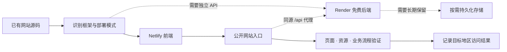

<div align="center">


# AI Website Deploy Skill

### 把已经写好的网站，部署成真正能用的链接。

**一个 Agent Skill，而不是另一个网站模板。**

[](SKILL.md)
[](https://www.netlify.com/)
[](https://render.com/)
[](references/access-and-data.md)

[快速开始](#-30-秒开始) · [工作方式](#-它会做什么) · [大陆与海外访问](#-中国大陆与海外都能看吗) · [用户数据](#-需要后端或用户数据时) · [English](README.md)

</div>

---

## ✦ 从“本地跑起来”，到“别人也能打开”

界面已经写好了，接下来却是另一套问题：发布目录怎么选？私有仓库怎么授权？API 地址放哪里？服务显示上线，为什么前端还是连不上？

**AI Website Deploy Skill 把这些步骤整理成可复用的部署技能。** 让 Agent 接手已有项目，优先使用免费方案，保留原有设计，完成配置、发布与真实联调。有后端需求再加后端，有数据需求再选择存储。

> **这是什么？** 一套供 Codex 等支持 `SKILL.md` 的 Agent 使用的指令和参考资料。它不自带云账号，不代替 Netlify / Render，也不是免配额的免费云服务。

<table>
<tr>
<td width="33%"><h3>↗ 前端先上线</h3><p>识别现有框架、构建命令和发布目录。默认部署到 Netlify，不重新设计你的网站。</p></td>
<td width="33%"><h3>⌘ 后端按需添加</h3><p>需要 API、计算或共享状态时，连接 Render Free Web Service。纯前端不额外创建资源。</p></td>
<td width="33%"><h3>✓ 验证完整流程</h3><p>从公开网站域名验证页面、资源和 API。写入后再独立读取，不把“已触发部署”当作成功。</p></td>
</tr>
</table>

## ⚡ 30 秒开始

### 1 · 安装技能

在 Codex 中发送：

```text
帮我安装这个 GitHub 仓库中的 skill：
https://github.com/chrisoops500/ai-website-deploy-skill
```

也可以手动克隆到本地技能目录（需要 Git；目标目录不能已存在）：

```bash
git clone https://github.com/chrisoops500/ai-website-deploy-skill.git \
  ~/.codex/skills/ai-website-deploy-skill
```

若已存在同名技能，请先比较内容，避免覆盖个人修改。安装后在新对话中调用。

### 2 · 打开已有网站项目

准备网站源码，以及需要使用的平台账号。支持连接器、官方 CLI 或必要的浏览器操作；具体能力取决于 Agent 环境。

| 你要部署什么 | 需要准备什么 |
| --- | --- |
| 纯前端网站 | 网站源码、Netlify 账号 |
| 前端 + 独立后端 | 以上内容，加 Render 账号、Git 仓库及部署授权 |
| 前端 + 用户数据 | 以上内容，加数据保留要求及合适的存储连接 |

### 3 · 一句话调用

```text
使用 $ai-website-deploy-skill 部署这个已有网站。
优先免费方案，保留现有界面，源码仓库保持私有。
面向中国大陆和海外用户，检查页面、静态资源和 API 的访问情况。
如果需要后端再添加；如果涉及用户数据，先确定是否要长期保存。
```

<details>
<summary><b>更多可直接复制的场景</b></summary>

**只部署展示网站**

```text
使用 $ai-website-deploy-skill 把这个作品集部署到 Netlify。
不需要后端、不需要数据库。保留原设计，检查手机端和资源加载。
```

**接入轻量 API**

```text
使用 $ai-website-deploy-skill 部署这个前后端项目。
前端放 Netlify，后端选 Render 免费运行方案，用同源 /api 代理连接。
本次只做功能测试，不需要长期保存数据。
```

**评论 / 表单 / 账号数据**

```text
使用 $ai-website-deploy-skill 部署这个应用。
用户数据需要跨浏览器、跨部署长期保留。先比较可用免费存储方案与限制，
不要把 Render 临时磁盘或 localStorage 当成持久化后端。
```

</details>

## ◇ 它会做什么



| 阶段 | 实际工作 |
| --- | --- |
| **发现** | 读取已有项目、构建设置、环境变量和 Git 状态，复用已有资源 |
| **连接** | 确认账号、工作区和仓库授权；源码默认私有，公开网站单独管理 |
| **配置** | 设置实际发布目录、`PORT`、健康接口和必要的 `/api` 代理 |
| **发布** | 跟踪目标提交，等待 Netlify `ready` / Render `live` |
| **联调** | 从网站域名访问 API；必要时完成一次真实写入与重新读取 |
| **交付** | 给出访问链接、已验证范围、免费额度与存储生命周期边界 |

## 🌏 中国大陆与海外都能看吗？

**目标是服务两边的访客，验收以实际网络测试为准。** 公开 HTTPS 地址或“全球 CDN”不能证明每个地区、每家运营商都稳定可用。

技能会检查以下环节：

- 尽量把可分发的字体、图标、脚本和图片随网站打包，减少关键外部依赖。
- 分别验证首页、静态资源、API 和交互，避免“页面能开、按钮不能用”。
- 有目标地区测试点时执行验证；没有时明确标注未测，并提供实测步骤。
- 按需配置已有自定义域名；不自动购买域名，也不把换域名说成通用保证。

**本仓库不宣称 Netlify 默认域名在中国大陆始终可用，也没有把单一网络测试包装成全球测试。** 如果业务要求大陆与海外稳定访问，需要结合真实域名、网络、资源依赖与托管方案评估。[查看地区验收方法 →](references/access-and-data.md)

## ⌘ 需要后端或用户数据时

后端和数据库是两个独立决定。**不需要 SQL，就不强行添加 SQL；需要数据长期保留，就不拿临时文件冒充。**

| 模式 | 适合什么 | 数据如何处理 |
| --- | --- | --- |
| **Frontend only** | 作品集、展示页、纯浏览器工具 | 不创建后端或存储 |
| **Frontend + API** | 计算、接口联调、临时共享状态 | 可使用内存或 JSON；明确可能丢失 |
| **Frontend + API + Data** | 评论、表单、账号、附件 | 根据保留要求接入既有或合适的持久化存储 |

Render Free 的本地文件会在重启、重新部署或休眠后丢失。免费 Web Service 的月度运行额度，与免费 PostgreSQL 的使用期限是不同规则。数据有保留要求时，技能会分别核实额度、到期、权限与恢复方式。[Render 官方免费规则](https://render.com/docs/free)

> 用户数据不会写入公开源码仓库。连接串和管理员凭据只放服务端；涉及个人数据时还需验证身份与数据隔离。

## ◌ 免费，具体意味着什么？

**优先选择当时可用的 $0/月托管计划，在其额度和条款内运行。** 不意味着不限流量、不休眠、永久保存数据，也不代表域名或额外存储永远免费。

| 平台 | 本技能的用法 | 部署前核实 |
| --- | --- | --- |
| Netlify | 前端托管与必要的 API 代理 | 当前账号计划、用量额度、构建和超额行为 |
| Render | 按需使用 Free Web Service | 可用免费计划、共享额度、冷启动、临时磁盘 |
| 可选存储 | 按数据需求选择 | 免费期限、容量、读写、备份与超额规则 |

平台规则会变化。技能要求**每次部署查询官方当前文档**，不会因额度不足自行开通付费计划。

[Netlify 计费文档](https://docs.netlify.com/manage/accounts-and-billing/) · [Render 免费方案](https://render.com/docs/free) · [平台操作参考](references/providers.md)

## ↳ 私有仓库部署，容易漏掉哪一步？

给 Render 安装 GitHub App，还不一定完成全部连接：

```text
GitHub App 可访问目标仓库
          +
Render 已连接 Git Deployment Credentials
          +
服务使用正确的 Git Credentials
          =
私有源码可以拉取和构建
```

**GitHub 登录方式 ≠ Git 部署凭据。** 仓库从 Public 改成 Private 后，要验证下一次构建是否仍能克隆源码。这是本技能从实际部署流程中提炼出的重点之一。

## ▤ 仓库里有什么

```text
.
├── SKILL.md                       Agent 的执行入口
├── agents/openai.yaml             技能名称与调用提示
├── references/
│   ├── providers.md               平台配置、权限与故障恢复
│   └── access-and-data.md         地区访问与用户数据策略
├── assets/                        本项目的封面与图标
├── README.md                      英文首页
└── README.zh-CN.md                 中文说明
```

**它不会替你重新写一个网站，也不会让人把密钥粘进聊天。** 这份技能专注把已有项目交付到可验证的线上状态。

## ✧ 反馈与贡献

欢迎提交 [Issue](https://github.com/chrisoops500/ai-website-deploy-skill/issues) 或 Pull Request，分享可复现的部署问题、文档变化和访问测试。

报告问题时请提供框架、失败阶段和脱敏日志；地区访问问题附实际网络地区与测试时间。**不要上传 token、连接串、用户数据或未经同意的日志。**

---

<div align="center">

**Ship something real. Keep the limits visible.**

让网站上线，也让“免费”和“可用”有据可查。

[开始使用 ↑](#-30-秒开始)

</div>
